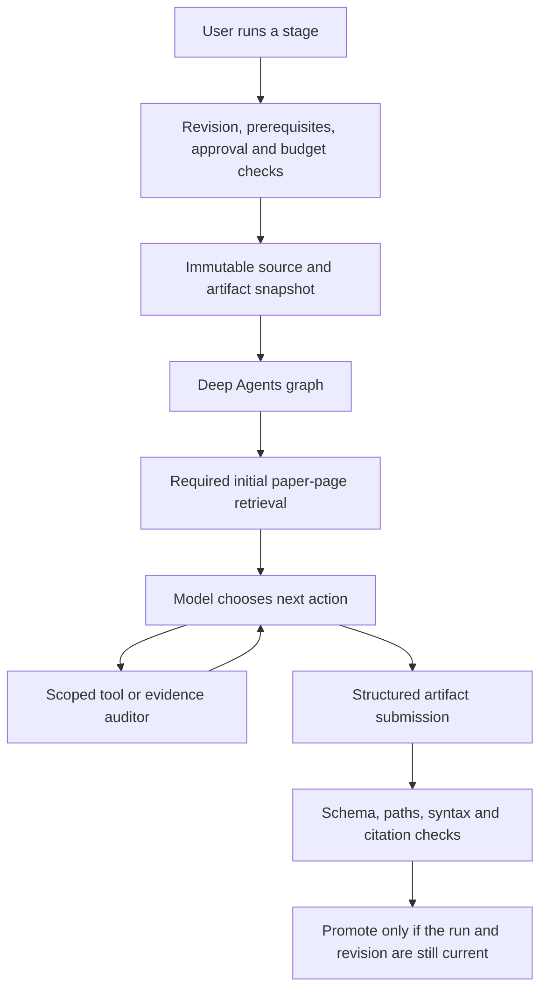

# PaperLab agents: implementation and research

Updated 2 November 2026. The workflow now uses Deep Agents 0.7.32, LangGraph 1.2.19,
LangChain 1.4.7, langchain-groq 1.1.3 and SQLite checkpoint support, pinned in `uv.lock`.

## Research findings and chosen design

The Deep Agents SDK constructs an agent graph from a chat model, domain tools, middleware,
filesystem backend and optional subagents. This was checked against the current
[SDK overview](https://docs.langchain.com/oss/python/deepagents/overview) and the actual
[graph builder source](https://github.com/langchain-ai/deepagents/blob/main/libs/deepagents/deepagents/graph.py).
PaperLab uses that SDK directly rather than implementing another bespoke model/tool loop.

The model chooses actions after seeing tool results. Its available tools and state determine
what it can do. PaperLab keeps the scientific workflow controller outside the graph: the
controller still owns revisions, exact-plan approval, budget admission and artifact promotion.
This separation lets a role iterate without letting model output authorize another stage.

[Middleware hooks](https://docs.langchain.com/oss/python/langchain/middleware/custom) intercept
model and tool calls. PaperLab uses them for cancellation, call limits, input-size checks,
usage aggregation and the public action trace. The model cannot raise its own limits.

[Compiled subagents](https://docs.langchain.com/oss/python/deepagents/subagents) provide focused
delegation with a separate context. PaperLab exposes one evidence auditor to analysis, planning
and review. Its graph explicitly receives the same budget/cancellation controller; it cannot
spawn more agents or acquire coding/execution tools. Delegation is optional, not a forced call.

[StateBackend](https://docs.langchain.com/oss/python/deepagents/backends) gives the code agent a
virtual filesystem. PaperLab uses it for `/draft/` files, with write permissions scoped to that
prefix. It does not connect Deep Agents to the host filesystem. Generated code is parsed for
syntax and checked for required files, never executed.

[LangGraph checkpointers](https://docs.langchain.com/oss/python/langgraph/persistence) persist
thread state. PaperLab uses a run UUID as its thread ID and local SQLite storage. Checkpoints
are retained for inspection; API restart still marks in-flight runs interrupted and explicit
retry starts a new run. User-facing checkpoint resumption is future work.

## Where the code lives

| File under `services/api/paperlab_api/` | Responsibility |
| --- | --- |
| `agents/registry.py` | Eight role definitions, tool allowlists, coding and delegation capabilities |
| `agents/runtime.py` | `create_deep_agent`, ChatGroq, compiled evidence auditor, ToolStrategy, checkpoint wiring |
| `agents/tools.py` | Paper search/page reading, artifact retrieval, static project validation and metric retrieval |
| `agents/guard.py` | Shared parent/subagent accounting, bounded loops, cancellation and action events |
| `agents/model.py` | Groq tool-choice compatibility; preserves the forced initial evidence call |
| `agents/validation.py` | Sends incomplete final code drafts back for up to two repair rounds |
| `research_prompts.py` | Domain instructions for each role |
| `research.py` | Workflow admission, approval, feedback, immutable snapshots, event persistence, final artifact validation |
| `research_schemas.py` | Output, task graph and export-path validation |

The Angular `research/agent-trace.ts` component displays action events. It shows tool names,
agent identity and model/tool counts, not raw model reasoning. The previous `groq_client.py`
single-call implementation is retained as a compatibility module; `ResearchService` defaults
to `DeepResearchAgent`.

## One request in practice

For example, the implementation author reads the paper and can inspect the accepted plan,
write `/draft/evaluator.py`, call `validate_project`, see a syntax error, edit that file and
validate again. The final response contains prose and metadata; exported file contents come
from the virtual filesystem so the model does not need to repeat the code in its final answer.
If the agent submits incomplete code early, validation returns the missing files or syntax
errors to the same graph for up to two repair rounds within the shared call budget. Groq can
finish through the structured output tool or a plain JSON answer; both must pass the same
artifact schema and final static checks. Unstructured prose is rejected.

The planner can use `write_todos`; the final task list still has validated IDs, dependencies
and acceptance criteria. The reviewer can inspect and validate the current code but cannot
edit it. Results/report roles can fetch self-reported metrics; no role can manufacture verified
execution evidence through a tool.

## Human control, cost and remaining limits

Guided mode still requires approval of the exact current plan before a code agent starts.
Feedback cancels affected work and invalidates downstream artifacts. The agent checks the
current run/revision before every model or tool call. An already-started provider request may
finish and incur cost; stale output cannot be promoted. All stored feedback enters the new run.

Tool-level HITL interrupts are a separate capability described in the
[Deep Agents HITL documentation](https://docs.langchain.com/oss/python/deepagents/human-in-the-loop).
PaperLab currently uses application-level approval. It has no shell, paid compute launch or
publication tool to approve within a graph. Adding these requires scoped execution adapters,
durable tool decisions and independent result checks.

Each stage reserves estimated spend for the bounded loop, including any specialist calls.
Unknown usage keeps the reservation. Guard limits are twelve model attempts, 24 tool calls,
30,000 serialized input bytes per model request and 6,000 output tokens per call. The ten-minute
limit is checked between operations; an in-flight request can run until its provider timeout.
HTTP 429 responses can trigger at most four bounded waits/retries, each at most 60 seconds and
counted against the shared model-attempt limit. Cancellation is checked during waits; other
failures stop with an actionable error. SDK retries remain disabled.
This design deliberately uses bounded retrieval rather than automatic summarization that
would introduce extra model calls outside the shared accounting middleware.

This is a single-process local runtime. There is no GPU worker, arbitrary command execution,
MCP platform connector, independent execution grader, authenticated multi-user service or
automatic resume of interrupted checkpoints. Exports remain the Colab/Kaggle/VS Code handoff.

## Verification

`tests/test_agents.py` invokes the real graph with a scripted ChatGroq-compatible model. It
checks retrieval, specialist delegation and shared usage, virtual file repair, denied writes,
checkpoints, cancellation, loop bounds, and API trace persistence. Other tests retain the
existing approval, feedback, revision, budget and export checks. Browser tests exercise the
trace display with controlled responses. Live checks use only a fresh fictional methodology
fixture and do not establish reproduction of a real paper.

The final backend suite passed 65 tests and Ruff. Four research browser scenarios and the
Angular build passed during the integration. The live code-agent fixture completed retrieval,
three virtual file writes, static validation, two rate-limit recoveries and ZIP export in eight
model attempts. Analysis and planning were also checked live separately; the final code test
used deterministic setup artifacts to avoid repeating those provider calls.
